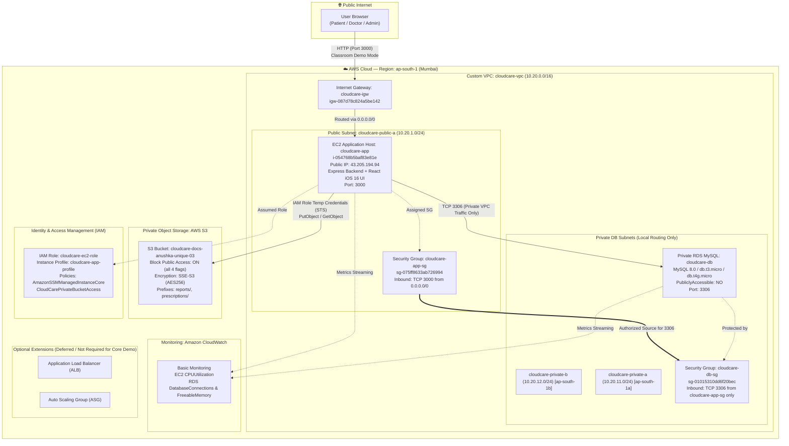

# CloudCare Architecture & Security Blueprint (Simplified TY CCF Edition v3.0)

## System Architecture Diagram

---

## Security Invariants

1. **Database Isolation**: The RDS MySQL database (`cloudcare-db`) is deployed in private subnets with `PubliclyAccessible: false`. Inbound TCP port 3306 is permitted **only from the application security group** (`sg-075ff8633ab726994`), preventing any direct internet access.
2. **S3 Security**: The S3 bucket (`cloudcare-docs-anushka-unique-03`) has **Block Public Access enabled across all four settings** and default Server-Side Encryption (`AES256`). EC2 interacts with S3 exclusively via temporary IAM instance profile credentials (`cloudcare-app-profile`), with zero static access keys stored on disk or committed to Git.
3. **No Secrets in Source Control**: Verified via `git ls-files` that no `.env` files, `.pem` keys, or credentials exist in the Git tree.
