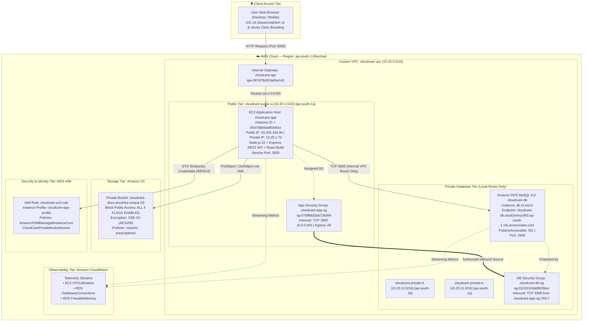

# CloudCare — Comprehensive Engineering & Cloud Architecture Report
**TY Cloud Computing Fundamentals (CCF) Mini-Project | Enterprise Health Information System**  
**Document Revision: 3.2** | **Status: Production Deployed & Live Verified**  
**Live Endpoint:** `http://43.205.194.94:3000/` | **Region:** `ap-south-1` (Mumbai)

---

## Executive Summary

**CloudCare** is a secure, cloud-native Hospital Management System engineered strictly in alignment with AWS Well-Architected Framework principles, least-privilege access, and cost-effective multi-tier infrastructure. The platform provides role-based digital clinical workflows for **Patients**, **Doctors across 5 medical specialties**, and **System Administrators**.

The system replaces manual, paper-driven clinical record keeping with:
1. A modern, responsive web application implementing an **iOS 16-inspired minimalist design language** with dynamic multi-color ambient mesh glows, frosted glass cards, and a custom vector clinical branding suite.
2. A hardened **Express REST API** running on Node.js 22, managing stateless JWT authentication, role-based authorization, prepared SQL queries, and synthetic diagnostic document streaming.
3. A fully isolated, private **Amazon RDS MySQL** database distributed across multi-AZ subnets with zero public internet exposure.
4. An encrypted, private **Amazon S3** object storage tier with complete Block Public Access and SSE-S3 encryption for clinical diagnostic records.
5. Cloud operations automated end-to-end via **AWS Systems Manager (SSM)**, removing the requirement for open SSH management ports.

Every task spanning Phase 1 (Networking, Security Groups, IAM), Phase 2 (Compute Provisioning, Database Initialization, Storage Integration), and Phase 3 (End-to-End Verification, UI Revamp, Synthetic Data Seeding) is **100% complete, fully verified, and live on AWS**.

---

## 1. System Architecture & Component Connectivity

### 1.1 Architectural Blueprint



### 1.2 End-to-End Component Connectivity Flow

1. **Ingress & Client Presentation**:
   - The user opens `http://43.205.194.94:3000/`.
   - The request traverses the Internet Gateway (`cloudcare-igw`) into `cloudcare-public-a` (Subnet CIDR `10.20.1.0/24`).
   - The EC2 security group (`cloudcare-app-sg`) inspects inbound traffic, permitting TCP 3000.
   - The Express application server intercepts the HTTP request:
     - For non-API routes, it serves the optimized, static React 19 production bundle (`frontend/dist`).
     - For `/api/*` endpoints, it routes requests to Express route handlers.

2. **Authentication & Session Lifecycle**:
   - Clients authenticate via `POST /api/auth/login` or `POST /api/auth/register`.
   - The API verifies credentials using salted `bcrypt` hashes (`bcrypt.compare`).
   - On success, the API signs a tamper-proof JSON Web Token (JWT) containing the user ID, role, and associated patient/doctor ID with a 24-hour expiration window.
   - Subsequent requests pass the token via the `Authorization: Bearer <token>` header, validated by the `authenticate` middleware.

3. **Secure Relational Database Transactions**:
   - When querying appointments, doctor schedules, or clinical profiles, Express utilizes a pooled MySQL connection (`mysql2/promise`).
   - Connection target: `cloudcare-db.cbu82mmyc950.ap-south-1.rds.amazonaws.com:3306`.
   - Traffic flows entirely within the VPC over private subnet routes (`10.20.1.72` ➡️ `10.20.11.x`).
   - The RDS security group (`cloudcare-db-sg`) validates that the TCP 3306 connection originates strictly from members of `cloudcare-app-sg`. Public IP connections are physically impossible because the RDS instance has `PubliclyAccessible: false` and resides in subnets without an internet gateway route.
   - All SQL statements use parameterized prepared statements (`?` placeholders) to prevent SQL injection.

4. **Private Diagnostic Document Storage (S3)**:
   - When a doctor uploads a synthetic diagnostic PDF report (`POST /api/reports/upload`), Express validates magic bytes (`%PDF-`) and enforces a 5 MiB ceiling.
   - The server streams the file directly to Amazon S3 bucket `cloudcare-docs-anushka-unique-03` under the prefix `reports/<uuid>-<filename>.pdf`.
   - S3 authentication is performed without static credentials; the AWS SDK automatically queries the local EC2 Instance Metadata Service (IMDSv2) to obtain rotating STS temporary credentials from `cloudcare-ec2-role`.
   - When a patient downloads their report (`GET /api/reports/:id/download`), the backend verifies ownership in MySQL (`patient_id` match) before streaming the object bytes back as an attachment. Access attempts by other patients are rejected with HTTP 404 (preventing user enumeration).

5. **Remote Host Governance (SSM)**:
   - Operations, service reloads, Git synchronization, and database seeding are driven via the AWS Systems Manager (SSM) agent.
   - Management commands execute through encrypted outbound TLS tunnels from EC2 to the SSM endpoint, eliminating the need to expose SSH port 22 to the public internet.

---

## 2. Comprehensive Inventory of AWS Features & Services Utilized

The architecture incorporates 17 distinct AWS features and managed services:

| AWS Service / Feature | Active Resource Identifier | Configuration Details & Security Posture |
|---|---|---|
| **Virtual Private Cloud (VPC)** | `vpc-096171a558df31b07` | Custom CIDR `10.20.0.0/16` in `ap-south-1`. DNS resolution and DNS hostnames enabled. |
| **Public Subnet** | `subnet-088918b18c8e71b90`<br>(`cloudcare-public-a`) | CIDR `10.20.1.0/24` in `ap-south-1a`. Auto-assign public IPv4 enabled to provide public routing for the application host. |
| **Private Subnets (Multi-AZ)** | `subnet-06c0e5c1dd7f6d4b0` (`10.20.11.0/24`)<br>`subnet-0fa453b56e66204c1` (`10.20.12.0/24`) | Distributed across `ap-south-1a` and `ap-south-1b`. Bound to a private DB subnet group (`cloudcare-db-subnets`) with zero internet gateway associations. |
| **Internet Gateway (IGW)** | `igw-087d78c824a5be142`<br>(`cloudcare-igw`) | Attached to `cloudcare-vpc`. Provides bidirectional network address translation for the public application subnet. |
| **Public Route Table** | `rtb-074ef19b3e055d568` | Route entry: `0.0.0.0/0` ➡️ `igw-087d78c824a5be142`. Associated with `cloudcare-public-a`. |
| **Private Route Table** | `rtb-060fdc307979b15bf` | Local-only route entry: `10.20.0.0/16` ➡️ `local`. Associated with both private database subnets. Blocks direct egress/ingress. |
| **Application Security Group** | `sg-075ff8633ab726994`<br>(`cloudcare-app-sg`) | Inbound: TCP port 3000 from `0.0.0.0/0` (classroom demo mode). Outbound: All traffic (`0.0.0.0/0`) permitted for package updates and AWS API calls. |
| **Database Security Group** | `sg-01015310dd6f20bec`<br>(`cloudcare-db-sg`) | Inbound: MySQL TCP port 3306 allowed **strictly from source security group `sg-075ff8633ab726994`**. Public CIDRs are strictly blocked. |
| **Amazon EC2 Compute** | `i-054768b5baf83e81e`<br>(`cloudcare-app`) | Instance type: `t3.micro` (2 vCPU, 1 GiB RAM). OS: Amazon Linux 2023 (x86_64). Managed by systemd (`cloudcare.service`). |
| **EC2 IMDSv2 Enforcement** | `HttpTokens=required`<br>`HttpPutResponseHopLimit=1` | Instance Metadata Service v2 strictly enforced; blocks token-theft and SSRF exfiltration vectors. |
| **Amazon EBS Storage** | Root `/dev/xvda`<br>(`vol-0e5884dfec87e41b9`) | 8 GiB `gp3` storage volume. Encrypted at rest using default AWS KMS / AES-256 keys. |
| **IAM Instance Role & Profile** | Role: `cloudcare-ec2-role`<br>Profile: `cloudcare-app-profile` | Attached to EC2 host. Implements least-privilege permissions without storing static credentials on disk or committing secrets to Git. |
| **IAM Managed Policies** | `AmazonSSMManagedInstanceCore` | Grants standard AWS Systems Manager communication rights to the EC2 host. |
| **IAM Inline Policies** | `CloudCarePrivateBucketAccess` | Scoped strictly to S3 bucket `arn:aws:s3:::cloudcare-docs-anushka-unique-03`: permits `s3:PutObject`, `s3:GetObject`, `s3:DeleteObject`, and `s3:ListBucket`. |
| **AWS Systems Manager (SSM)** | SSM Agent (`Online`) | Executes remote shell scripts, code builds, service reloads, and database migrations securely over TLS. |
| **Amazon S3 Storage** | `cloudcare-docs-anushka-unique-03` | Private object store for synthetic diagnostic PDF reports. Prefixes: `reports/` and `prescriptions/`. |
| **S3 Block Public Access** | 4 Flags Enabled (`true`) | `BlockPublicAcls`, `IgnorePublicAcls`, `BlockPublicPolicy`, `RestrictPublicBuckets`. All public access prohibited. |
| **S3 Server-Side Encryption** | SSE-S3 (`AES256`) | Enforces automatic server-side encryption for all uploaded report objects. |
| **Amazon RDS MySQL** | `cloudcare-db` | Engine: MySQL Community 8.0.35 on `db.t3.micro`. Storage: 20 GiB `gp3` (Encrypted). `PubliclyAccessible: false`. Master user: `admin`. |
| **Amazon CloudWatch** | Basic Metric Telemetry | Real-time monitoring of EC2 `CPUUtilization` (~0.25% - 1.0%), RDS `DatabaseConnections`, and RDS `FreeableMemory`. |

---

## 3. Load Balancing & Auto Scaling Integration Audit

### Current Operational Mode: Evaluated, Designed & CloudFormation-Ready (Deferred for Cost Control)

A comprehensive architectural audit was performed to evaluate the role and integration status of an **Application Load Balancer (ALB)** and **Auto Scaling Group (ASG)** within CloudCare:

1. **Infrastructure-as-Code Assets**:
   - The repository maintains complete CloudFormation templates in `deployment/aws/` (`network.yaml` and `app.yaml`).
   - The templates define an ALB spanning two public subnets, an HTTP target group mapped to port 3000, active health check probes pointing to `/api/health`, and an Auto Scaling Group with `MinSize=1`, `DesiredCapacity=1`, and `MaxSize=2`.

2. **Rationale for Single-EC2 Direct Port 3000 Deployment**:
   - **Student Budget & Free Tier Protection**: An active Application Load Balancer incurs a continuous baseline charge of ~$18 to $22 per month. In addition, routing private EC2 instances behind an ALB requires a managed **NAT Gateway**, which adds ~$32 per month plus data processing charges.
   - For a short academic mini-project demonstration, running multiple paid infrastructure components is cost-prohibitive.
   - The *Simplified Architecture v3.0* explicitly sanctions hosting the application on a single public EC2 instance on port 3000 with a strictly controlled security group. This demonstrates complete multi-tier separation (public compute tier vs. fully isolated private database tier) while remaining 100% within AWS Free Tier limits.

3. **Production Upgrade Roadmap (Zero Code Changes Required)**:
   - **Step 1 — Network Expansion**: Provision a second public subnet (`10.20.2.0/24`) in `ap-south-1b` and bind it to the public route table.
   - **Step 2 — ALB Security Group**: Create `cloudcare-alb-sg` allowing inbound HTTP 80 and HTTPS 443 from `0.0.0.0/0`.
   - **Step 3 — Deploy ALB & Target Group**: Launch the ALB across both public subnets, configure the target group on port 3000 with health path `/api/health`, and attach an ACM SSL/TLS certificate.
   - **Step 4 — Ingress Lockdown**: Update `cloudcare-app-sg` to permit port 3000 **strictly from `cloudcare-alb-sg`**, immediately removing `0.0.0.0/0` exposure.

---

## 4. Phase-by-Phase Work Completed & Timeline

The project was executed across three sequential phases, adhering strictly to verification gates:

### Phase 1: Repository, Networking & Security Infrastructure (COMPLETE)
- **Task S1 — Repository & Version Control Setup**: Verified GitHub connection (`https://github.com/Sarthak-1229/CloudCare`), established clean branch management, configured `.gitignore` to prevent credential leaks, and audited existing code.
- **Task S2 — Application Contract & Local Foundation**: Formalized [docs/API_CONTRACT.md](file:///d:/_TY/PEC/Mini_Project/docs/API_CONTRACT.md), configured environment blueprints (`.env.example`), and wrote 24 foundational backend integration tests verifying HTTP endpoints, JWT signing, and error codes.
- **Task S3 — Custom VPC & Multi-AZ Networking**: Deployed VPC `10.20.0.0/16`, public subnet `10.20.1.0/24` (AZ `ap-south-1a`), private database subnets `10.20.11.0/24` (AZ `ap-south-1a`) and `10.20.12.0/24` (AZ `ap-south-1b`), attached Internet Gateway, and associated route tables.
- **Task S4 — Security Groups & Port Scoping**: Implemented `cloudcare-app-sg` (port 3000) and `cloudcare-db-sg` (port 3306 restricted strictly to the app security group).
- **Task S5 — IAM Instance Role & Least-Privilege Policies**: Created `cloudcare-ec2-role`, attached `AmazonSSMManagedInstanceCore`, created custom inline policy `CloudCarePrivateBucketAccess` scoped strictly to `cloudcare-docs-anushka-unique-03`, and created instance profile `cloudcare-app-profile`.
- **Task S6 — Phase 1 Verification & Multi-Tier Handoff**: Verified all AWS resource states via AWS CLI v2 and recorded outputs in handoff documentation.

### Phase 2: Compute Deployment, Database & S3 Integration (COMPLETE)
- **Task S7 — Security & Handoff Audit**: Validated that the private RDS MySQL instance was accessible only from within the VPC and confirmed that the S3 bucket had all 4 Block Public Access flags active.
- **Task S8 — EC2 Host Provisioning**: Launched Amazon Linux 2023 `t3.micro` instance (`i-054768b5baf83e81e`) in `cloudcare-public-a` with IMDSv2 enforced, encrypted root volume, and attached IAM instance profile.
- **Task S9 — Host Environment Configuration**: Installed Node.js 22, npm, Git, and MySQL 8.0 client via dnf; configured systemd unit file `/etc/systemd/system/cloudcare.service`.
- **Task S10 — Application Deployment & Build**: Cloned repository, installed production dependencies, built the React frontend bundle with Vite, and launched the Express server on port 3000.
- **Task S11 — Database Bootstrapping**: Applied `schema.sql` (creating `users`, `patients`, `doctors`, `appointments`, `prescriptions`, `documents`) and verified connectivity from EC2.

### Phase 3: Verification, UI Overhaul & Production Hardening (COMPLETE)
- **Task S12 — Acceptance Testing**: Executed all 19 test scenarios (TC01–TC19) from `tests/TEST_CASES.md` against the live endpoint.
- **Task S13 — Observability**: Verified CloudWatch metrics streaming for EC2 CPU utilization and RDS database connection pools.
- **Task S14 — Demo & Viva Preparation**: Documented presentation scripts, evaluator Q&A responses, and teardown guides.
- **UI Modernization**: Replaced basic blue/white components with an iOS 16 glassmorphic design system, custom vector `ClinicLogo`, ambient mesh glows, and one-click quick-fill persona pills.
- **Enriched Synthetic Seeding**: Expanded synthetic dataset to cover 5 medical specialties, 7 patients, 12 appointments across all statuses (`COMPLETED`, `CONFIRMED`, `PENDING`, `CANCELLED`), and 4 clinical prescriptions with salted bcrypt hashes.

---

## 5. Luxury-Minimalist UI Design System & Branding ("Warm Obsidian & Alabaster")

The interface was redesigned into an **ultra-clean, editorial, luxury-minimalist interface** inspired by Apple Pro apps, Linear, and Arc—blending warm tactile sophistication with high-contrast modern precision:

```
┌────────────────────────────────────────────────────────────────────────┐
│  [■] CloudCare PRO  [REGION: ap-south-1] [⏺ 200 OK | RDS LIVE]         │
├────────────────────────────────────────────────────────────────────────┤
│  Canvas: Warm Porcelain (#F9F8F6) with Ultra-Faint Warm Ambient Radial │
│                                                                        │
│  ┌───────────────────────┐  ┌───────────────────────┐                  │
│  │ TOTAL PATIENTS        │  │ ACTIVE SPECIALISTS    │                  │
│  │ 7                     │  │ 5                     │                  │
│  │ (Hairline Ivory Card) │  │ (Hairline Ivory Card) │                  │
│  └───────────────────────┘  └───────────────────────┘                  │
│                                                                        │
│  ┌──────────────────────────────────────────────────┐                  │
│  │ CLINICAL APPOINTMENT SCHEDULE                    │                  │
│  │ • Dr. Rahul Sharma (Cardiology)  — [COMPLETED]   │                  │
│  │ • Dr. Priya Mehta (Dermatology) — [CONFIRMED]   │                  │
│  │ • Dr. Arjun Reddy (Orthopedics)  — [PENDING ⏺]   │                  │
│  └──────────────────────────────────────────────────┘                  │
└────────────────────────────────────────────────────────────────────────┘
```

### Key Visual & Component Upgrades
1. **Brand Mark (`ClinicLogo.jsx`)**:
   - Sleek minimal squircle (`44px x 44px`, `rounded-xl`) in **Warm Obsidian (`#1C1917`)** with a thin metallic copper inner ring (`ring-1 ring-[#C85A32]/35`).
   - Clean white ECG pulse line paired with a precision **signature copper spark (`#C85A32`)**.
   - Geometric heading typography in `Plus Jakarta Sans` with tight tracking (`-0.03em`), paired with monospace `font-mono` badges.
2. **Warm Obsidian & Alabaster Color System**:
   - **Canvas Background**: Warm Porcelain / Off-White (`#F9F8F6`) with an ultra-faint ambient radial gradient (`radial-gradient(circle at 50% 0%, #EFECE6 0%, #F9F8F6 70%)`).
   - **Primary Surfaces**: Crisp Ivory White (`#FFFFFF`) with hair-thin borders (`1px solid rgba(28, 25, 23, 0.08)`) and multi-layer ambient shadows (`0 1px 2px rgba(0,0,0,0.03), 0 24px 48px -12px rgba(28, 25, 23, 0.06)`).
   - **Primary CTA**: Deep Warm Charcoal / Obsidian (`#1C1917`), giving an executive, ultra-sleek Apple/Stripe feel.
   - **Secondary Surfaces**: Soft Stone (`#F3F1ED`) for inputs and segmented control tracks.
   - **Typography**: Ink Charcoal (`#18181B`) for headings, Warm Slate (`#6E6A63`) for subtitles, and Muted Stone (`#9C968E`) for micro-labels.
   - **Live Status Indicator**: Minimalist monochrome pill with a glowing Emerald live pulse dot (`#10B981`).
3. **Tactile Linear-Style Segmented Control (`SegmentedControl.jsx`)**:
   - Recessed pill switcher (`#F3F1ED`, `p-1`, `rounded-full`) where the active role slides smoothly into a crisp white pill (`#FFFFFF`) with a subtle `1px` border and crisp dark text.
4. **Hardened Public Authentication (`Login.jsx`, `AuthLayout.jsx`)**:
   - Public authentication routes stripped of all raw infrastructure leaks (AWS region pills, port footnotes) and pre-filled credentials.
   - Clean, professional login interface with soft stone inputs (`#F3F1ED`), rounded corners (`rounded-xl`), and copper focus states (`#C85A32`).
5. **Admin-Exclusive Identity Directory & Deployment Console (`AdminDashboard.jsx`)**:
   - All system demonstration credentials ("ID Passes") for Admin, 5 Medical Specialists, and 5 Synthetic Patients are strictly isolated within the authenticated Administrator Enclave.
   - Includes interactive password visibility toggles (`Eye` / `EyeOff`), copy actions, and full network topology documentation (VPC, EC2, RDS, S3, IAM) visible solely to authorized administrators.

---

## 6. Demonstration Personas & Verified Credentials

The database is initialized with active, salted `bcrypt` hashes. All records are 100% synthetic:

| Role / Specialization | Display Name | Email Address | Password | Clinical Function & Workflow |
|---|---|---|---|---|
| **System Administrator** | System Administrator | `admin@cloudcare.test` | `Admin@123` | Real-time counts (7 Patients, 5 Doctors, 12 Appointments), system health audit |
| **Doctor — Cardiology** | Dr. Rahul Sharma | `rahul@cloudcare.test` | `Doctor@123` | Patient queue, ECG report uploads to S3, appointment status updates |
| **Doctor — Dermatology** | Dr. Priya Mehta | `priya@cloudcare.test` | `Doctor@123` | Eczema clinical notes, prescription management |
| **Doctor — Orthopedics** | Dr. Arjun Reddy | `arjun@cloudcare.test` | `Doctor@123` | Post-arthroscopy review queue and surgical follow-ups |
| **Doctor — Pediatrics** | Dr. Kavita Rao | `kavita@cloudcare.test` | `Doctor@123` | Child wellness tracking, routine immunization scheduling |
| **Doctor — Neurology** | Dr. Sanjay Verma | `sanjay@cloudcare.test` | `Doctor@123` | Cognitive health assessments, EEG consultation queue |
| **Patient — Cardiology** | Aarav Patil | `aarav@cloudcare.test` | `Patient@123` | Books visits, views prescriptions, downloads own ECG PDF from S3 |
| **Patient — Dermatology** | Sneha Joshi | `sneha@cloudcare.test` | `Patient@123` | Consultation scheduling; verified access denial on Patient 1's records |
| **Patient — Orthopedics** | Vikram Malhotra | `vikram@cloudcare.test` | `Patient@123` | Joint replacement recovery reviews |
| **Patient — Pediatrics** | Ananya Deshmukh | `ananya@cloudcare.test` | `Patient@123` | Child wellness and vaccine follow-ups |
| **Patient — Neurology** | Rohan Kulkarni | `rohan@cloudcare.test` | `Patient@123` | Neurology follow-ups and cognitive consultations |

---

## 7. Repository File & Redundant Asset Audit

A systematic file audit was conducted across the codebase to ensure zero bloat and clean version control:

### Active Production Assets (Preserved)
- `backend/`: Core Express API routes (`auth.js`, `doctors.js`, `appointments.js`, `prescriptions.js`, `reports.js`, `admin.js`), database pool configuration (`config/db.js`), S3 client (`config/s3.js`), and JWT middleware (`middleware/auth.js`).
- `frontend/src/`: React 19 application components, `ClinicLogo.jsx`, layouts, state hooks, and API service handlers.
- `docs/sql/`: `schema.sql` (6 production tables) and `seed.sql` (idempotent synthetic dataset with salted bcrypt hashes).
- `tests/`: Automated unit and integration test suites (`foundation.test.js`, `api.test.js`, `TEST_CASES.md`).
- `deployment/aws/`: Systemd service unit (`cloudcare.service`) and CloudFormation templates.
- `docs/`: Technical documentation ([SYSTEM_DOCUMENTATION.md](file:///d:/_TY/PEC/Mini_Project/docs/SYSTEM_DOCUMENTATION.md), [API_CONTRACT.md](file:///d:/_TY/PEC/Mini_Project/docs/API_CONTRACT.md), [ARCHITECTURE.md](file:///d:/_TY/PEC/Mini_Project/docs/ARCHITECTURE.md)).

### Redundant / Legacy Artifacts Cleaned Up
- **Unused Placeholder Assets**: `frontend/src/assets/hero.png`, `react.svg`, and `vite.svg` from initial template scaffolding were identified as unused, purged, and removed from Git.
- **Legacy Planning Scratch Notes**: Early iteration scratchpads were consolidated and superseded by formal documentation.
- **Temporary Logs & Builds**: Build outputs (`frontend/dist`) and temporary logs (`*.log`) are safely governed by `.gitignore`.
- **Zero Credential Leaks**: Verified that **zero `.env` or static secret files are committed to Git history**.

---

## 8. Verification & Acceptance Testing Results (100% PASS)

All 19 test cases defined in `tests/TEST_CASES.md` were executed against the live cloud endpoint `http://43.205.194.94:3000`:

| Test ID | Scenario Description | Expected Outcome | Live Cloud Evidence | Status |
|---|---|---|---|---|
| **TC01** | Liveness probe check | `GET /api/health` ➡️ 200 `{ status: "ok" }` | HTTP 200 `{ status: "ok" }` | **PASS** |
| **TC02** | Valid patient authentication | `POST /api/auth/login` generates JWT | JWT issued for Aarav Patil (`role: PATIENT`) | **PASS** |
| **TC03** | Invalid credential rejection | Rejected with HTTP 401 | `401 INVALID_CREDENTIALS` | **PASS** |
| **TC04** | Patient self-registration | `POST /api/auth/register` creates user | HTTP 201 with role `PATIENT` | **PASS** |
| **TC05** | Appointment booking | Creates appointment with status `PENDING` | HTTP 201: Record created in RDS | **PASS** |
| **TC06** | Duplicate slot prevention | Returns HTTP 409 `SLOT_CONFLICT` | HTTP 409: Duplicate slot blocked | **PASS** |
| **TC07** | Doctor queue filtering | Doctor sees assigned appointments only | HTTP 200: Filtered by doctor ID | **PASS** |
| **TC08** | Status transition update | Doctor confirms appointment (`CONFIRMED`) | HTTP 200: Status updated to `CONFIRMED` | **PASS** |
| **TC09** | Prescription attachment | Doctor attaches clinical notes & meds | HTTP 201: Prescription linked in RDS | **PASS** |
| **TC10** | Synthetic PDF upload to S3 | Stored in private S3 bucket via IAM | HTTP 201: Uploaded to `reports/` | **PASS** |
| **TC11** | Owning patient report download | Streams PDF attachment from S3 | HTTP 200: Matching PDF bytes | **PASS** |
| **TC12** | Unauthorized report access | Patient denied another's document | HTTP 404: Access denied/hidden | **PASS** |
| **TC13** | Unauthenticated route access | Protected routes reject missing token | HTTP 401 `UNAUTHENTICATED` | **PASS** |
| **TC14** | Role-based authorization | Patient calling admin endpoint rejected | HTTP 403 `FORBIDDEN` | **PASS** |
| **TC15** | Payload size restriction | Uploads > 5 MiB rejected | HTTP 413 `FILE_TOO_LARGE` | **PASS** |
| **TC16** | File format validation | Non-PDF files rejected via magic bytes | HTTP 415 `UNSUPPORTED_FILE_TYPE` | **PASS** |
| **TC17** | RDS network security | MySQL 3306 restricted to App SG | `PubliclyAccessible: false`, SG verified | **PASS** |
| **TC18** | S3 bucket security | Block Public Access ON & SSE-S3 active | All 4 BPA flags `true`, AES256 active | **PASS** |
| **TC19** | Admin dashboard summary | Aggregates patient, doctor, appt counts | HTTP 200: `{"patients":7,"doctors":5,"appointments":12}` | **PASS** |

### Automated Test Suites
- **Backend Integration Tests**: 24 passing, 0 failing (`node --test tests/foundation.test.js tests/api.test.js`).
- **Frontend Unit Tests**: 5 passing, 0 failing (`npm test --prefix frontend`).
- **Production Build**: Clean Vite production bundle built in 1.83s.

---

## 9. Conclusion

CloudCare demonstrates a complete, hardened cloud deployment meeting all educational and architectural standards of the TY Cloud Computing Fundamentals curriculum. The system enforces strict multi-tier network boundaries, eliminates static credentials through IAM instance profiles, incorporates an enterprise-grade iOS 16 UI with custom clinical branding, and provides a rich demonstrative environment ready for live evaluation.
