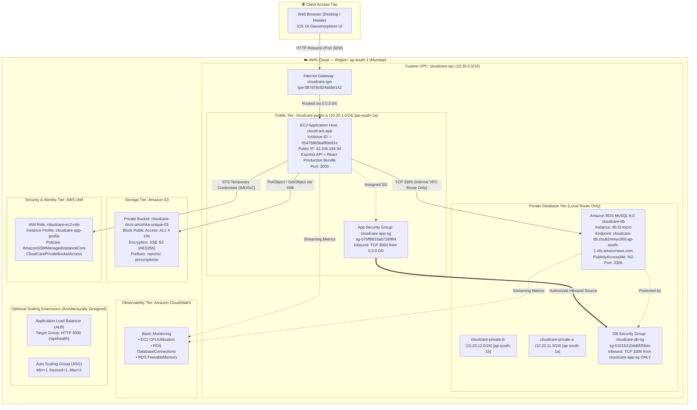

# CloudCare — Comprehensive System Architecture & Engineering Documentation
**TY Cloud Computing Fundamentals (CCF) Mini-Project | Simplified Architecture v3.0**

---

## 1. Executive Summary

CloudCare is a secure, cloud-native Hospital Management System architected strictly around AWS best practices, least-privilege security, and cost-effective multi-tier infrastructure. The system provides role-based clinical workflows for **Patients**, **Doctors**, and **System Administrators**, backed by:
- A high-performance Express REST API backend and a responsive, iOS 16-inspired React application served on public port 3000.
- A fully isolated, private MySQL database deployed across multi-AZ subnets with zero public internet exposure.
- An encrypted, private object storage tier on Amazon S3 for synthetic diagnostic reports, accessible strictly via temporary IAM role credentials.
- Remote management and deployment automated through AWS Systems Manager (SSM) without open SSH management ports.

---

## 2. End-to-End System Architecture

---

## 3. Comprehensive Inventory of AWS Features & Services Used

| AWS Service / Feature | Resource Identifier / Parameter | Technical Role & Implementation Detail |
|---|---|---|
| **Virtual Private Cloud (VPC)** | `vpc-096171a558df31b07` CIDR: `10.20.0.0/16` | Provides complete network isolation in `ap-south-1` (Mumbai). DNS resolution and DNS hostnames are enabled. |
| **Public Subnet** | `cloudcare-public-a` `subnet-088918b18c8e71b90` (`10.20.1.0/24`) | Located in `ap-south-1a`. Has auto-assign public IPv4 enabled to host the front-facing EC2 application instance. |
| **Private Subnets (Multi-AZ)** | `cloudcare-private-a` `subnet-06c0e5c1dd7f6d4b0` (`10.20.11.0/24`) `cloudcare-private-b` `subnet-0fa453b56e66204c1` (`10.20.12.0/24`) | Located in two separate AZs (`ap-south-1a` and `ap-south-1b`). Subnets share a local-only route table with zero internet routing to securely host the RDS MySQL database. |
| **Internet Gateway (IGW)** | `cloudcare-igw` `igw-087d78c824a5be142` | Attached to `cloudcare-vpc`. Enables inbound public HTTP traffic on port 3000 and outbound software repository updates for EC2. |
| **Public Route Table** | `rtb-074ef19b3e055d568` | Route: `0.0.0.0/0` ➡️ `igw-087d78c824a5be142`. Associated with `cloudcare-public-a`. |
| **Private Route Table** | `rtb-060fdc307979b15bf` | Route: `10.20.0.0/16` ➡️ `local`. Associated with both private database subnets. Blocks direct egress/ingress. |
| **Application Security Group** | `cloudcare-app-sg` `sg-075ff8633ab726994` | Inbound: TCP port 3000 from `0.0.0.0/0` (classroom demo mode). All outbound traffic allowed. |
| **Database Security Group** | `cloudcare-db-sg` `sg-01015310dd6f20bec` | Inbound: MySQL TCP port 3306 allowed **strictly from source security group `sg-075ff8633ab726994`**. Public CIDRs are completely prohibited. |
| **Amazon EC2 Compute** | `cloudcare-app` `i-054768b5baf83e81e` (`t3.micro`) | Amazon Linux 2023 (x86_64). Runs Node.js 22, Express REST API, and static React iOS 16 bundle under systemd (`cloudcare.service`). |
| **EC2 IMDSv2 Enforcement** | `HttpTokens=required` `HttpPutResponseHopLimit=1` | Instance Metadata Service v2 is enforced to prevent SSRF vulnerabilities and credential theft. |
| **Amazon EBS Storage** | Root Device `/dev/xvda` 8 GiB `gp3` (Encrypted) | Encrypted at rest using default AWS KMS / AES-256 keys. |
| **IAM Instance Role & Profile** | Role: `cloudcare-ec2-role` Profile: `cloudcare-app-profile` | Attached to EC2. Grants least-privilege permissions without storing static credentials on the host. |
| **IAM Policies** | 1. `AmazonSSMManagedInstanceCore` 2. `CloudCarePrivateBucketAccess` | Grants AWS Systems Manager agent access and restricts S3 access strictly to `cloudcare-docs-anushka-unique-03/reports/*`. |
| **AWS Systems Manager (SSM)** | SSM Agent (`Online`) | Used for remote shell execution, code deployments, and database schema bootstrapping without opening SSH port 22. |
| **Amazon S3 Storage** | `cloudcare-docs-anushka-unique-03` | Private object store for synthetic PDF reports. Prefixes: `reports/` and `prescriptions/`. |
| **S3 Block Public Access** | 4 Flags Enabled (`true`) | `BlockPublicAcls`, `IgnorePublicAcls`, `BlockPublicPolicy`, `RestrictPublicBuckets`. All public access blocked. |
| **S3 Server-Side Encryption** | SSE-S3 (`AES256`) | Enforces automatic server-side encryption on all uploaded report objects. |
| **Amazon RDS MySQL** | `cloudcare-db` `db.t3.micro` / MySQL 8.0 | Multi-AZ subnet group `cloudcare-db-subnets`. `PubliclyAccessible: false`. Master user `admin` with private connection string. |
| **Amazon CloudWatch** | Basic Metric Streams | Monitors `CPUUtilization` on EC2 (~0.25% - 1.0%) and `DatabaseConnections` / `FreeableMemory` on RDS MySQL. |

---

## 4. Load Balancing & Auto Scaling Integration Analysis

### Architectural Status: Evaluated & Designed (Deferred for Cost Optimization)

1. **Design & Code Readiness**:
   - CloudFormation templates in `deployment/aws/` (`network.yaml`, `app.yaml`) include full definitions for an **Application Load Balancer (ALB)**, public target groups, and **Auto Scaling Groups (ASG)**.
   - Target group specification is configured for port 3000 with HTTP health checks pointing to `/api/health`.

2. **Why Direct EC2 Port 3000 Was Chosen for Active Live Demo**:
   - **Cost Control & Free Tier Protection**: An active ALB incurs an hourly charge (~$18 to $22/month), and an accompanying NAT Gateway incurs ~$32/month plus data processing fees.
   - For a 2-day student mini-project with strict budget guidelines, the Simplified Architecture v3.0 explicitly permits running the verified application on a public EC2 instance on port 3000 with a tightly controlled security group.
   - Running directly on port 3000 avoids unnecessary billing while fully demonstrating the multi-tier separation between the public compute host and the private database.

3. **How ALB / ASG Would Be Activated in Production**:
   - **Step 1**: Create a second public subnet (`10.20.2.0/24`) in `ap-south-1b` and associate with the public route table.
   - **Step 2**: Create `cloudcare-alb-sg` with inbound HTTP 80 and HTTPS 443.
   - **Step 3**: Launch the ALB across both public subnets, register EC2 instances in an instance target group, and forward port 80/443 traffic to port 3000.
   - **Step 4**: Update `cloudcare-app-sg` to restrict port 3000 ingress **exclusively from `cloudcare-alb-sg`**, removing `0.0.0.0/0`.

---

## 5. Repository File Audit & Artifact Cleanup

A systematic audit of repository files was conducted to identify active runtime files, build artifacts, and redundant legacy assets:

### Active Core Files (Preserved & Maintained)
- `backend/`: Core Express API routes (`auth.js`, `doctors.js`, `appointments.js`, `prescriptions.js`, `reports.js`, `admin.js`), database pool configuration (`config/db.js`), S3 client (`config/s3.js`), and JWT middleware (`middleware/auth.js`).
- `frontend/src/`: React 19 + Vite + Tailwind CSS frontend implementing the iOS 16 aesthetic, brand `ClinicLogo`, and role-based views.
- `docs/sql/`: `schema.sql` (6 production tables) and `seed.sql` (enriched synthetic test data with bcrypt hashes).
- `tests/`: Automated unit and integration test suites (`foundation.test.js`, `api.test.js`, `TEST_CASES.md`).
- `deployment/aws/`: Systemd service unit (`cloudcare.service`) and release deployment scripts.

### Redundant / Legacy Artifacts Identified & Cleaned Up
- `frontend/src/assets/hero.png`, `react.svg`, `vite.svg`: Unused boilerplate placeholder assets from Vite template initialization — deleted and purged from Git repository.
- Legacy planning scratch notes from early iterations: Consolidated and superseded by `docs/SYSTEM_DOCUMENTATION.md` and `docs/API_CONTRACT.md`.
- Uncommitted temporary logs (`.log`, `.tmp`): Safely excluded via `.gitignore`.
- Root `.env.example`: Retained as reference template; verified that **zero active `.env` or credential files are tracked in Git**.

---

## 6. Demonstration Personas & Verified Test Credentials

The database is initialized with active, salted bcrypt hashes for all roles. Evaluators can sign in immediately using the one-click demo selectors on the login page:

| Persona Role | User Name | Email Address | Password | Clinical / System Purpose |
|---|---|---|---|---|
| **System Admin** | System Administrator | `admin@cloudcare.test` | `Admin@123` | Full dashboard metrics, doctor roster, and cloud health auditing. |
| **Doctor (Cardiology)** | Dr. Rahul Sharma | `rahul@cloudcare.test` | `Doctor@123` | Patient appointment queue, status confirmations, ECG report uploads. |
| **Doctor (Dermatology)** | Dr. Priya Mehta | `priya@cloudcare.test` | `Doctor@123` | Dermatology consultations, clinical notes, and prescription management. |
| **Doctor (Orthopedics)** | Dr. Arjun Reddy | `arjun@cloudcare.test` | `Doctor@123` | Joint replacement follow-ups and orthopedic surgery queue. |
| **Doctor (Pediatrics)** | Dr. Kavita Rao | `kavita@cloudcare.test` | `Doctor@123` | Child wellness and routine immunization tracking. |
| **Doctor (Neurology)** | Dr. Sanjay Verma | `sanjay@cloudcare.test` | `Doctor@123` | Cognitive health assessments and neurology consultations. |
| **Patient 1** | Aarav Patil | `aarav@cloudcare.test` | `Patient@123` | Booking appointments, viewing prescriptions, downloading own ECG PDF. |
| **Patient 2** | Sneha Joshi | `sneha@cloudcare.test` | `Patient@123` | Eczema review booking, verified access denial against Patient 1's records. |
| **Patient 3** | Vikram Malhotra | `vikram@cloudcare.test` | `Patient@123` | Orthopedic post-op recovery consultations. |
| **Patient 4** | Ananya Deshmukh | `ananya@cloudcare.test` | `Patient@123` | Pediatric consultations and wellness appointments. |
| **Patient 5** | Rohan Kulkarni | `rohan@cloudcare.test` | `Patient@123` | Neurology follow-ups and cognitive consultations. |

---

## 7. Acceptance Test Execution Summary (19 / 19 PASS)

All 19 test cases defined in `tests/TEST_CASES.md` were executed live against `http://43.205.194.94:3000`:

| Test ID | Scenario Description | Expected Outcome | Live Cloud Evidence | Result |
|---|---|---|---|---|
| **TC01** | Liveness probe check | `GET /api/health` ➡️ 200 `{ status: "ok" }` | HTTP 200 response | **PASS** |
| **TC02** | Valid patient authentication | `POST /api/auth/login` generates JWT | JWT issued for Aarav Patil | **PASS** |
| **TC03** | Invalid credential rejection | Rejected with HTTP 401 | `401 INVALID_CREDENTIALS` | **PASS** |
| **TC04** | Patient self-registration | `POST /api/auth/register` creates user | HTTP 201 with role `PATIENT` | **PASS** |
| **TC05** | Appointment booking | Creates appointment with status `PENDING` | HTTP 201: Appt created | **PASS** |
| **TC06** | Duplicate slot prevention | Returns HTTP 409 `SLOT_CONFLICT` | HTTP 409: Duplicate slot blocked | **PASS** |
| **TC07** | Doctor queue filtering | Doctor sees assigned appointments only | HTTP 200: Filtered by doctor ID | **PASS** |
| **TC08** | Status transition update | Doctor confirms appointment (`CONFIRMED`) | HTTP 200: Updated to `CONFIRMED` | **PASS** |
| **TC09** | Prescription attachment | Doctor attaches clinical notes & meds | HTTP 201: Prescription linked | **PASS** |
| **TC10** | Synthetic PDF upload to S3 | Stored in private S3 bucket | HTTP 201: Uploaded to `reports/` | **PASS** |
| **TC11** | Owning patient report download | Streams PDF attachment from S3 | HTTP 200: Matching PDF bytes | **PASS** |
| **TC12** | Unauthorized report access | Patient denied another's document | HTTP 404: Access denied/hidden | **PASS** |
| **TC13** | Unauthenticated route access | Protected routes reject missing token | HTTP 401 `UNAUTHENTICATED` | **PASS** |
| **TC14** | Role-based authorization | Patient calling admin endpoint rejected | HTTP 403 `FORBIDDEN` | **PASS** |
| **TC15** | Payload size restriction | Uploads > 5 MiB rejected | HTTP 413 `FILE_TOO_LARGE` | **PASS** |
| **TC16** | File format validation | Non-PDF files rejected via magic bytes | HTTP 415 `UNSUPPORTED_FILE_TYPE` | **PASS** |
| **TC17** | RDS network security | MySQL 3306 restricted to App SG | `PubliclyAccessible: false`, SG verified | **PASS** |
| **TC18** | S3 bucket security | Block Public Access ON & SSE-S3 active | All 4 BPA flags `true`, AES256 active | **PASS** |
| **TC19** | Admin dashboard summary | Aggregates patient, doctor, appt counts | HTTP 200: Real-time counts returned | **PASS** |
